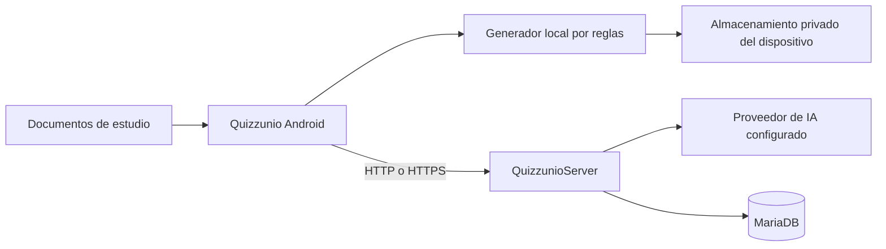

# Quizzunio

Quizzunio es una aplicación Android para estudiantes que quieren repasar apuntes y materiales de clase mediante la práctica activa. Convierte el texto de los documentos en cuestionarios de selección múltiple y permite revisar las respuestas para reforzar lo aprendido.

## Cómo funciona

1. En **Inicio**, selecciona **Nuevo cuestionario** y adjunta uno o más archivos **PDF, TXT, DOCX o PPTX** con texto legible.
2. Escribe un nombre, elige entre **1 y 15 preguntas** y genera el cuestionario. En Premium, **Generar local** y **Generar con IA** son acciones independientes.
3. Responde las preguntas. Puedes volver a Inicio y retomar el intento con el progreso guardado.
4. Al finalizar, consulta el resultado y revisa las respuestas correctas e incorrectas. Selecciona **Reintentar** para practicar de nuevo con el mismo cuestionario.

En Inicio puedes buscar por nombre, filtrar por **Todos**, **Recientes** o **Completados**, y distinguir los cuestionarios por intentar, en progreso y completados. El menú de cada cuestionario permite renombrarlo o eliminarlo. En **Ajustes** puedes elegir el tema **Sistema**, **Claro** u **Oscuro**.

Con una sesión activa y conexión al servidor, Inicio carga automáticamente los cuestionarios de la cuenta. Desliza hacia abajo para actualizar la lista y selecciona **Cargar más** para ver otras páginas.

## Modalidades de uso

| Funcionalidad | Anónimo | Free | Premium |
| --- | --- | --- | --- |
| Generación local | Sí | Sí | Sí |
| Generación con IA mediante QuizzunioServer | — | — | Sí |
| Almacenamiento local y progreso | En el espacio anónimo del dispositivo | En el espacio de la cuenta | En el espacio de la cuenta |
| Cuestionarios asociados a la cuenta en el servidor | — | Consulta y guardado de respuestas | Consulta, guardado de respuestas y almacenamiento automático de los generados con IA |
| Reutilización de cuestionarios | Sí | Sí | Sí |
| Gestión de cuenta | Registro e inicio de sesión disponibles | Perfil y gestión de cuenta | Perfil y gestión de cuenta |

El registro crea una cuenta **Free**. **Premium** es una modalidad de acceso asignada por el servidor. Los cuestionarios generados localmente quedan en el dispositivo, tanto en modo anónimo como con una cuenta.

## Generación de cuestionarios

### Generación local

Android extrae el texto y aplica reglas para construir preguntas y alternativas a partir del material. La generación se realiza en el dispositivo y funciona sin servicios remotos. El resultado depende de la cantidad y la claridad del texto disponible.

### Generación mediante IA

Android extrae el texto y lo envía a QuizzunioServer junto con el nombre y la cantidad de preguntas. El servidor solicita la generación al proveedor configurado, valida el resultado y lo guarda en MariaDB. Android recibe el cuestionario y permite abrirlo de inmediato o volver a Inicio para resolverlo después.

La comunicación con el proveedor de IA ocurre exclusivamente en el servidor. Si se interrumpe la conexión antes de confirmar el resultado, elige **Consultar generación pendiente** para comprobar el estado de la misma operación y recuperar el cuestionario si el servidor ya lo guardó.

## Cuentas, almacenamiento y seguridad

En **Ajustes → Cuenta** puedes iniciar sesión con tu usuario o correo, cerrar sesión, cambiar la contraseña o eliminar la cuenta. Para registrarte, selecciona **¿No tienes cuenta? Regístrate** en la pantalla de inicio de sesión. La app comprueba que el perfil corresponda a los datos del registro antes de abrir la cuenta y muestra indicaciones sobre el campo que requiere corrección cuando puede identificarlo. Si el registro queda sin confirmar, puedes pasar a **Iniciar sesión** para comprobar el acceso.

Al abrir la app, esta puede recuperar la sesión desde un respaldo local válido y verifica la identidad con el servidor. Si la verificación se interrumpe, puedes reintentarla o abandonar la sesión solo en el dispositivo. Cuando el abandono queda registrado en el dispositivo, la sesión anterior permanece desactivada al volver a abrir la app.

Los cuestionarios y sus avances se guardan en el almacenamiento privado de Android. El espacio anónimo se mantiene separado de los espacios identificados por cuenta y servidor. Al cerrar sesión se recupera el acceso a los cuestionarios anónimos guardados en el dispositivo.

Los tokens de sesión se guardan cifrados con una clave protegida por Android Keystore. QuizzunioServer protege las contraseñas mediante hashes Argon2id y almacena los cuestionarios remotos en MariaDB.

## Arquitectura y tecnologías

**Android** gestiona la interfaz, los documentos, la generación local, la sesión y el almacenamiento del dispositivo. Está escrito en Kotlin con arquitectura MVVM, ViewModel, Jetpack Compose, Material 3 y Navigation Compose. Usa DataStore para preferencias, Storage Access Framework para seleccionar documentos, PDFBox Android para extraer texto de PDF y Gradle con Kotlin DSL para compilar.

**QuizzunioServer** es un servicio independiente escrito en Java con Javalin. Autentica y autoriza las solicitudes, valida los cuestionarios, realiza la generación con IA y administra la persistencia de cuentas, sesiones y cuestionarios en MariaDB.



## Compilación y ejecución

- Usa un dispositivo o emulador con **Android 9** o posterior (`minSdk 28`).
- Instala **Android SDK 37** para compilar (`compileSdk 37`). La aplicación apunta a esa misma API (`targetSdk 37`).
- El Gradle Wrapper usa **Gradle 9.5.0** y el proyecto fija **JDK 25** para el proceso de Gradle. El código Java del módulo Android tiene compatibilidad de compilación y destino **Java 11**. Java 27 corresponde al servidor.

Para ejecutar la app en Android Studio, clona el repositorio, abre su carpeta raíz, configura JDK 25 para Gradle e instala la plataforma Android SDK 37 desde SDK Manager. Sincroniza el proyecto, selecciona la configuración del módulo `app` y ejecútala en un dispositivo o emulador.

También puedes compilar y ejecutar las pruebas unitarias desde la raíz con el Gradle Wrapper. Para usarlo desde la terminal, configura `JAVA_HOME` con el JDK y `ANDROID_HOME` con la ubicación del SDK.

```bash
./gradlew assembleDebug
./gradlew testDebugUnitTest
```

En Windows, usa `.\gradlew.bat` con las mismas tareas. El APK de depuración se genera en `app/build/outputs/apk/debug/app-debug.apk`.

## Configuración del servidor

En **Ajustes → Servidor**, ingresa la URL base de una instancia compatible de QuizzunioServer. Selecciona **Aplicar servidor** y usa **Comprobar estado del servidor** para consultar la conexión. Si tienes una sesión abierta, ciérrala o abandónala localmente antes de cambiar de servidor.

Usa **HTTPS** en redes no confiables. La app también admite **HTTP** para redes controladas y solicita confirmación antes de aplicar la dirección. Puedes usar el modo anónimo para generar, resolver y revisar cuestionarios locales sin configurar un servidor. El registro, el inicio de sesión, las operaciones sobre cuestionarios remotos y la generación con IA requieren conexión al servidor.

Para identificar y recuperar operaciones de generación con IA, el servidor debe admitir el contrato de idempotencia y tener aplicada la migración `docs/migrations/quiz_generation.sql` de QuizzunioServer. Esta se aplica después de las migraciones anteriores de cuestionarios y antes de aceptar solicitudes con clave de idempotencia. Consulta la documentación del servidor para administrarla.

## Estructura del proyecto

```text
app/
├── src/main/
│   ├── java/cl/quizzunio/
│   │   ├── auth/       # Cuentas y sesiones
│   │   ├── core/       # Modelos y utilidades de texto
│   │   ├── network/    # Comunicación HTTP
│   │   ├── settings/   # Preferencias
│   │   ├── study/      # Documentos, generación y cuestionarios
│   │   └── ui/         # Pantallas, navegación y tema
│   └── res/
├── src/test/           # Pruebas unitarias
└── src/androidTest/    # Pruebas instrumentadas
docs/maquetas/          # Diseños de las pantallas
gradle/                 # Wrapper y catálogo de dependencias
```

## Contexto académico

Quizzunio se desarrolló como proyecto académico de la asignatura **Desarrollo de Aplicaciones Móviles II**.
